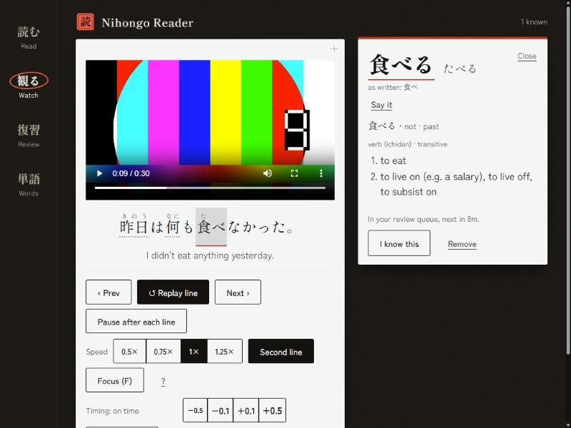

# Nihongo Reader

A free, open source study app for Japanese learners. Read real Japanese or watch your own videos with Japanese subtitles, tap any word for its meaning, save it, and review it later. No account, no setup, and your files never leave your computer.



## What it does

- **Read:** paste Japanese and get furigana over the kanji. Tap a word for its meaning and save it.
- **Watch:** drop in a video and its subtitle file (`.srt`, `.vtt` or `.ass`). The current line shows with furigana and tappable words. You can replay a line, pause after each one, slow things down, and fix subtitles that are out of sync.
- **Review:** saved words come back as flashcards with spaced repetition (FSRS), so they actually stick.
- **Words:** see everything you've saved, mark words as known, and export to Anki as CSV.

Furigana can show on every word, only on words you don't know yet, or not at all.

## Run it locally

You need Node.js 20 or later.

```bash
npm install
npm run dev
```

Then open http://localhost:5173.

Run the tests:

```bash
npm test
```

## Translation (optional)

The app works fully without translation. If you want sentence translation in the Read tab, deploy the small Cloudflare Worker in `/worker` with your own DeepL API key:

1. Run `wrangler deploy` from inside `/worker`.
2. Set the key with `wrangler secret put DEEPL_API_KEY`.
3. Copy `.env.example` to `.env` and set `VITE_TRANSLATE_WORKER_URL` to your worker's URL.

If the URL isn't set, the translation area doesn't show up at all.

## Privacy

Everything runs in your browser. Videos and subtitle files are played straight from your computer and never uploaded. Saved words live in your browser's storage. There's no tracking.

## Phone apps

The repo includes a Capacitor setup for iOS and Android builds (`npm run cap:sync`, `npm run cap:ios`, `npm run cap:android`). They aren't the focus right now, so expect rough edges.

## Contributing

Issues and pull requests are welcome. Keep changes small and focused, run `npm test` before you open a PR, and say what you tested in the browser.

## Credits

- **JMdict** dictionary data © the Electronic Dictionary Research and Development Group, used under the [Creative Commons Attribution-ShareAlike 4.0 licence](https://www.edrdg.org/edrdg/licence.html).
- **kuromoji.js** by Takuya Asano, Apache License 2.0. It ships the **IPADIC** dictionary, which has its own permissive licence.
- Spaced repetition by **ts-fsrs** (MIT).

## Licence

MIT. See [LICENSE](LICENSE).
